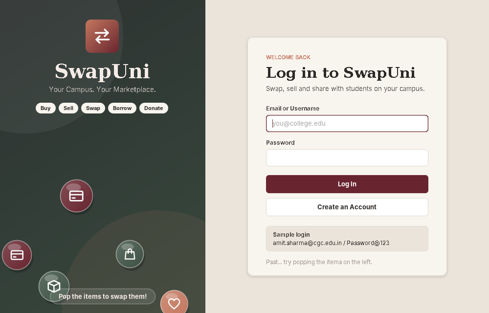
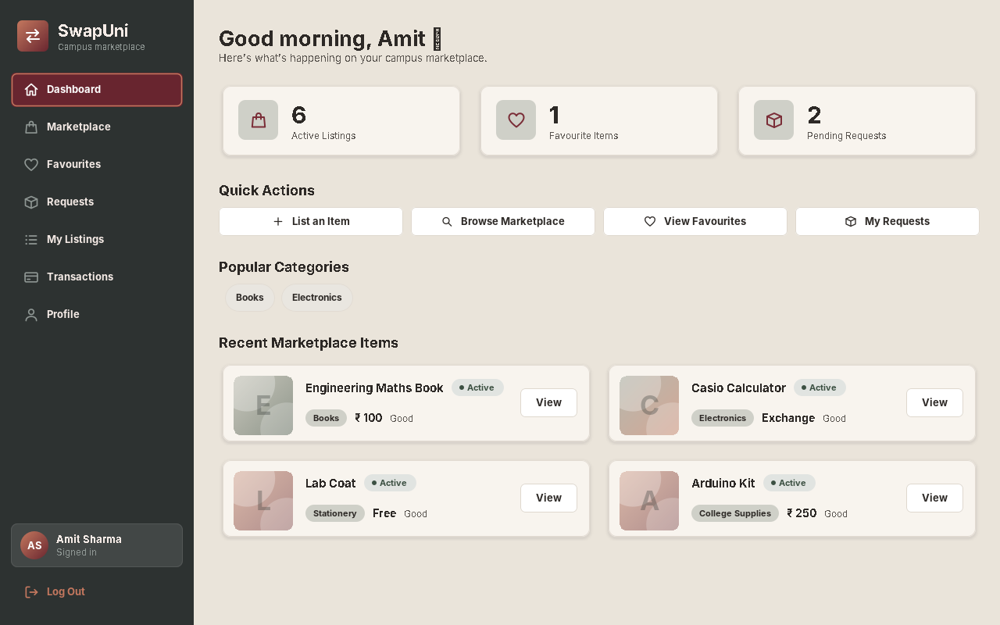
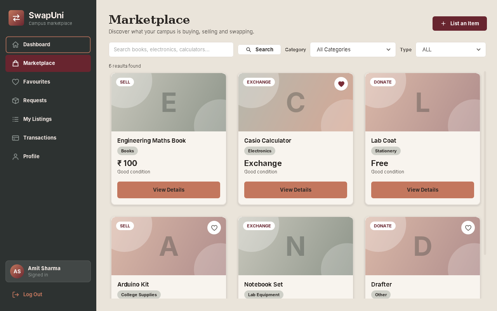
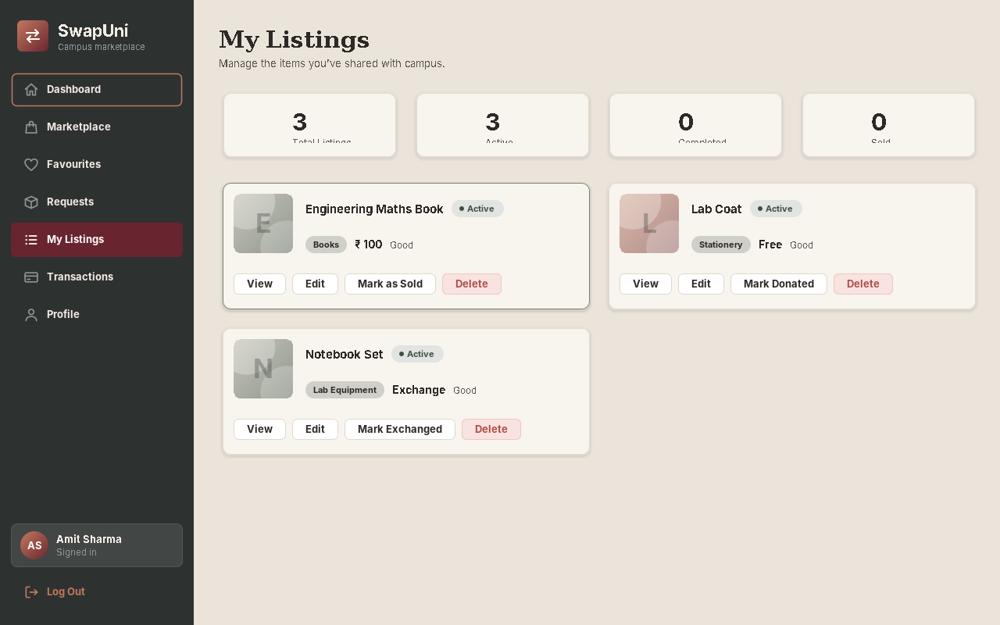
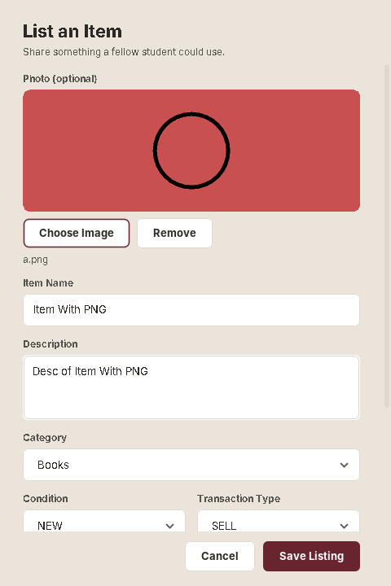
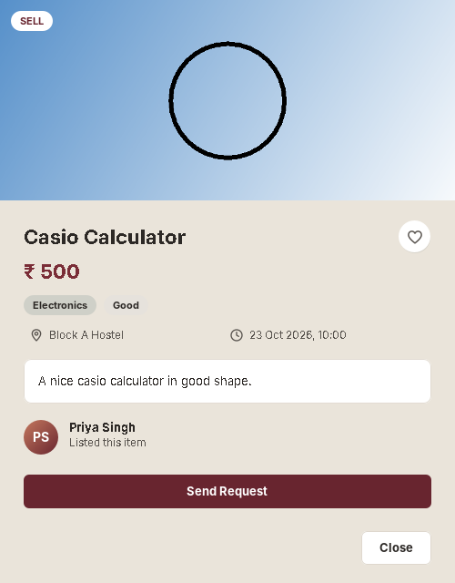

# SwapUni - Campus Marketplace (BCA 3C Java Project)

> **Group No:** `<8>`
> **Team members:** `<Shruti Mishra (92500527147)>`, `<Kinjalba Jadeja (92500527125)>`
> **Class / Subject:** BCA 3C - Java Project
> **Institute:** MARWADI UNIVERSITY, Rajkot

SwapUni is a **Java Swing desktop application** with a **Spring Boot REST backend** and a **MySQL** database.
College students can buy, sell, exchange, borrow and donate pre-owned items (books, calculators, lab gear...) on their own campus.
Everything runs as one program: it starts the backend, then opens the desktop window.

## Features
| Module | What it does |
|---|---|
| 1. Authentication & Profile | Sign up, log in, log out, edit profile. Passwords are hashed with BCrypt. |
| 2. Marketplace / Listings | Browse, search, filter by category/type, add / edit / delete your own listings **with a photo**. |
| 3. Requests | Send buy / exchange / borrow requests; owners accept or reject; requesters cancel. |
| 4. Favourites | Save items to a wishlist. |
| 5. My Listings & Transactions | Manage your items and see a transaction history. |
| 6. Dashboard | Counts, quick actions, popular categories, recent items. |

**Newest upgrades:** product photo upload (JPG/PNG/WEBP/GIF, up to 5 MB, live preview), responsive side-by-side card grids,
SwapYuni colour theme, resizable/maximizable windows, and a click mini-game ("Pop the Swap") on the login screen.

## Technology
Java 17 - Java Swing - Spring Boot 3.2.5 - Spring Data JPA - Gradle - MySQL 8 - BCrypt (spring-security-crypto) - Jackson - webp-imageio

## Repository layout
```
BCA3C_Java_Project/
|-- README.md
|-- documents/            project report (DOCX + PDF) and screenshots/
|-- database/             uniswap_db.sql  (schema reference - tables are also auto-created)
`-- code/                 full source code (Gradle project)
    |-- build.gradle, settings.gradle
    |-- Create-SwapUni-Shortcut.bat   (optional: builds SwapUni.exe + Desktop shortcut on Windows)
    `-- src/main/java/com/uniswap/{gui, controller, service, repository, model, dto, config, exception, util}
```

## How to run (Windows / PowerShell)
Requirements: JDK 17+, Gradle 7.6+, MySQL 8 running.

```powershell
cd code
$env:DB_USERNAME="root"
$env:DB_PASSWORD="your_mysql_password"
gradle bootRun
```
The database `uniswap_db` and its tables are created automatically on first start (nothing to import).
Uploaded product photos are saved in `C:\Users\<you>\SwapUni\uploads` (change with the `UPLOAD_DIR` environment variable).

**Sample login (created on first run):** `amit.sharma@cgc.edu.in` / `Password@123`

Optional single-click launcher: double-click `code/Create-SwapUni-Shortcut.bat` - it builds `SwapUni.exe` and a Desktop shortcut.

## Screenshots
| Login | Dashboard |
|---|---|
|  |  |
| **Marketplace** | **My Listings** |
|  |  |
| **Add listing with photo** | **Item details** |
|  |  |

## Database (tables)
`users`, `categories`, `listings` (incl. `image_url`), `favourites`, `requests`, `transactions` - see `database/uniswap_db.sql`.
